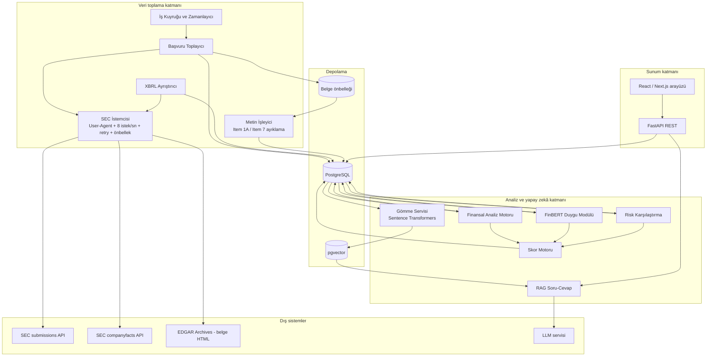
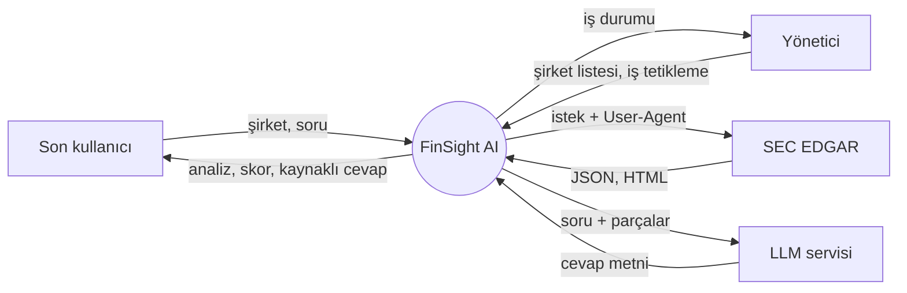
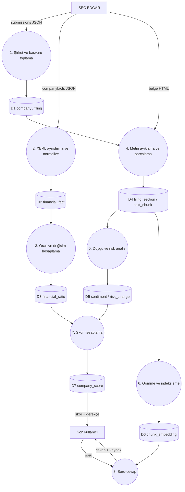
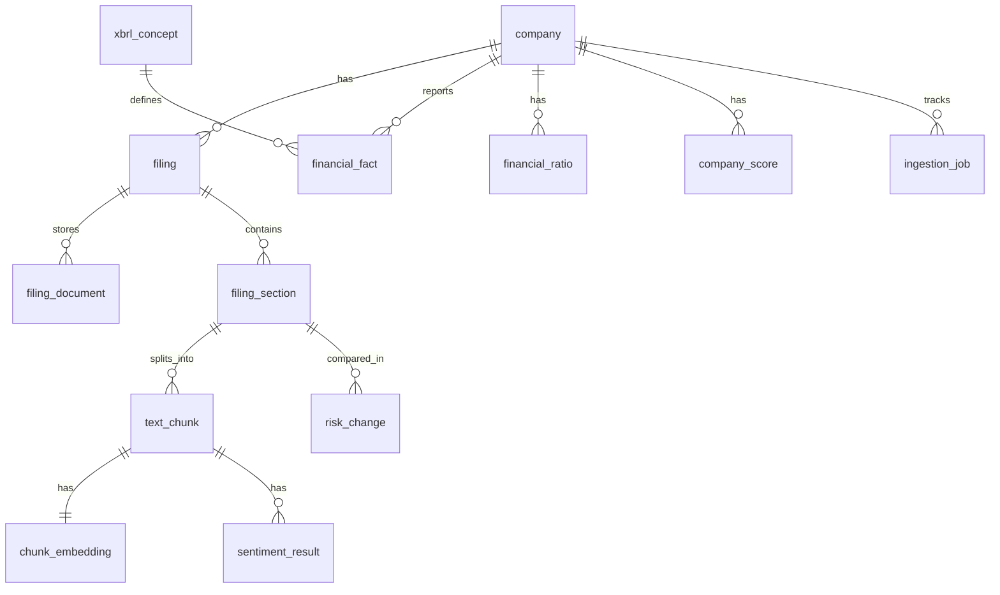

# FinSight AI — Birinci Aşama: Analiz ve Tasarım

Oct 10, 2026 · @Mert Çelik

## 1. Problem tanımı

ABD'de halka açık şirketlerin finansal raporları SEC EDGAR üzerinden ücretsiz erişilebilir, ancak bu raporların uzunluğu ve teknik dili, uzman olmayan okuyucu için anlamlı bilgiye ulaşmayı zorlaştırır. Bir 10-K raporu yüzlerce sayfa tutabilir; sayısal veriler XBRL etiketleriyle, risk ve yönetim değerlendirmeleri ise serbest metinle sunulur.

Bu iki veri türü genellikle ayrı araçlarla incelenir. Sayısal analiz (oranlar, dönemsel değişim) ile metinsel analiz (risk faktörlerindeki değişim, yönetim söyleminin tonu) aynı ortamda, birbirine bağlı ve kaynağı izlenebilir biçimde sunulmamaktadır. Ayrıca genel amaçlı büyük dil modelleri finansal sorulara kaynaksız ve doğrulanamayan cevaplar üretebilir (halüsinasyon).

**Problem cümlesi:** SEC raporlarındaki yapılandırılmış (XBRL) ve yapılandırılmamış (metin) verileri tek bir sistemde birleştirerek; dönemsel finansal değişimleri hesaplayan, metinsel risk ve duygu sinyallerini çıkaran ve kullanıcı sorularını yalnızca rapor içeriğine dayanarak, kaynak göstererek cevaplayan açıklanabilir bir analiz platformu nasıl tasarlanabilir?

**Araştırma soruları**

1. XBRL companyfacts verisinden farklı şirketler için tutarlı ve karşılaştırılabilir finansal göstergeler hangi kurallarla çıkarılabilir?
2. FinBERT gibi alana özgü bir dil modeli, 10-K/10-Q metinlerindeki ton değişimlerini dönemler arasında anlamlı biçimde yakalayabilir mi?
3. Erişim destekli üretim (RAG), finansal soru-cevapta kaynak gösterme oranını ve doğruluğu, kaynaksız LLM cevabına göre ne ölçüde artırır?
4. Sayısal ve metinsel sinyalleri birleştiren 100 puanlık bir skor, her bileşeni gerekçelendirilebilir (açıklanabilir) biçimde nasıl kurulabilir?

Bu soruların cevapları projenin değerlendirme aşamasında (hafta 11-14) ölçülecektir; bu raporda yalnızca hipotez olarak yer alırlar.

## 2. Amaç ve kapsam

Amaç, seçilen bir ABD şirketinin SEC raporlarından finansal göstergeleri ve metinsel risk sinyallerini otomatik çıkaran, soruları kaynak göstererek cevaplayan ve açıklanabilir bir finansal sağlık skoru üreten web tabanlı bir prototip geliştirmektir. Sistem bir karar destek aracıdır; yatırım tavsiyesi üretmez.

**Alt hedefler**

1. SEC EDGAR'dan 10-K, 10-Q ve 8-K başvurularını kurallara uygun (User-Agent, hız sınırı) biçimde toplamak.
2. XBRL companyfacts verisinden son 3 mali yılın temel kalemlerini çıkarıp normalize etmek.
3. 8-10 temel finansal oranı ve dönemsel değişimleri hesaplamak.
4. Risk Faktörleri (Item 1A) ve MD&A (Item 7) bölümlerinde FinBERT ile cümle düzeyinde duygu analizi yapmak.
5. Ardışık iki 10-K'nın risk bölümlerini karşılaştırıp eklenen ve çıkarılan riskleri işaretlemek.
6. Rapor parçalarına dayalı, kaynak gösteren bir RAG soru-cevap modülü kurmak.
7. Bileşenleri ve ağırlıkları görünür 100 puanlık bir skor üretmek.
8. Tüm sistemi Docker Compose ile tek komutla çalışır hâle getirmek.

| Kapsam içi (v1) | Kapsam dışı (v1) |
| --- | --- |
| Yalnızca ABD şirketleri, en az 10 şirketlik sabit liste | Tüm borsa şirketlerinin toplu taranması |
| 10-K, 10-Q, 8-K formları | 20-F, S-1, 13F, Form 4 gibi diğer formlar |
| Son 3 mali yıl karşılaştırması | Uzun dönem (10+ yıl) zaman serisi analizi |
| 8-10 temel oran | Sektöre özel ileri metrikler (ör. banka sermaye oranları) |
| FinBERT duygu analizi, risk bölümü karşılaştırma | Model eğitimi veya ince ayar (zorunlu değil, opsiyonel) |
| Kaynak gösteren soru-cevap | Kesin hisse fiyatı tahmini |
| Açıklanabilir 100 puanlık skor | Alım-satım önerisi, finansal tavsiye |
| Web arayüzü, Docker Compose | Mobil uygulama, gerçek parayla işlem, portföy optimizasyonu |

**Varsayım:** Şirket listesi farklı sektörlerden seçilecek (ör. teknoloji, perakende, enerji, sağlık). Finansal kuruluşlar (bankalar) XBRL kalemleri farklı olduğu için v1 listesinde sınırlı tutulmalıdır.

## 3. Hedef kullanıcılar

| Kullanıcı grubu | İhtiyaç | Sistemin sunduğu |
| --- | --- | --- |
| Bireysel yatırımcı ve finans okuru | Uzun raporu hızlı anlamak | Özet göstergeler, risk değişimi, kaynaklı cevap |
| Finans ve işletme öğrencileri | Oran analizini gerçek veride görmek | Hesaplama adımları görünür oranlar |
| Akademik araştırmacılar | Metin ve sayısal veriyi birlikte incelemek | Dışa aktarılabilir veri, duygu skorları |
| Finansal analist (ön inceleme) | Birden çok şirketi hızlı taramak | Şirketler arası karşılaştırma ekranı |
| Sistem yöneticisi | Veri güncelliğini korumak | Veri çekme işlerini izleme ve yeniden başlatma |

Sistem profesyonel yatırım kararının tek dayanağı olarak tasarlanmamıştır; bu sınır arayüzde açıkça belirtilecektir (bkz. Bölüm 13).

## 4. Fonksiyonel gereksinimler

Öncelik: Z = zorunlu (v1'de olmalı), İ = istenen (zaman kalırsa).

| Kimlik | Gereksinim | Öncelik | Kabul ölçütü |
| --- | --- | --- | --- |
| FR-01 | Kullanıcı şirketi ticker, şirket adı veya CIK ile arayabilmeli. | Z | "AAPL" araması doğru CIK'yi (0000320193) döndürür. |
| FR-02 | Sistem şirketin 10-K, 10-Q ve 8-K başvuru listesini submissions API'sinden çekmeli. | Z | Liste form türü, tarih ve accession numarasıyla gösterilir. |
| FR-03 | Sistem seçilen başvurunun ana HTML belgesini EDGAR arşivinden indirip saklamalı. | Z | Belge yerel olarak kaydedilir; aynı belge ikinci kez indirilmez. |
| FR-04 | Sistem companyfacts verisinden gelir, net kâr, toplam varlık, toplam borç, özkaynak, işletme nakit akışı gibi kalemleri çıkarmalı. | Z | Her değer kaynak accession, form ve dönem bilgisiyle saklanır. |
| FR-05 | Sistem son 3 mali yıl ve son çeyrekler için dönemsel değişimi (YoY, QoQ yüzde) hesaplamalı. | Z | Değişimler birim testlerinde elle hesaplanan değerlerle eşleşir. |
| FR-06 | Sistem 8-10 finansal oranı (bkz. Bölüm 11) hesaplamalı ve formülünü göstermeli. | Z | Eksik veri olduğunda oran "hesaplanamadı" olarak işaretlenir, sıfır yazılmaz. |
| FR-07 | Sistem 10-K/10-Q metninden Item 1A (Risk Faktörleri) ve Item 7 (MD&A) bölümlerini ayıklamalı. | Z | 10 şirketin en az 8'inde bölüm sınırları elle kontrolde doğru çıkar. |
| FR-08 | Sistem bölüm metinlerinde FinBERT ile cümle düzeyinde pozitif/negatif/nötr sınıflandırması yapmalı. | Z | Her cümle etiket ve olasılık değeriyle saklanır; bölüm özeti oran olarak verilir. |
| FR-09 | Sistem iki dönemin risk bölümlerini karşılaştırıp yeni, kaldırılmış ve değişmiş risk paragraflarını listelemeli. | Z | Karşılaştırma ekranında üç grup ayrı gösterilir. |
| FR-10 | Kullanıcı rapor hakkında doğal dilde soru sorabilmeli; cevap, ilgili bölüm alıntısı ve belge bağlantısıyla verilmeli. | Z | Her cevapta en az bir kaynak parça bulunur; kaynak yoksa sistem "raporda bulunamadı" der. |
| FR-11 | Sistem bileşenleri ve ağırlıkları görünür 100 puanlık finansal sağlık ve risk skoru üretmeli. | Z | Skorun her alt bileşeni ayrı puan ve gerekçeyle gösterilir. |
| FR-12 | Arayüz finansal kalemleri ve oranları zaman serisi grafikleriyle göstermeli. | Z | En az gelir, net kâr ve borç grafikleri çalışır. |
| FR-13 | Kullanıcı iki şirketi seçilen oranlar üzerinden yan yana karşılaştırabilmeli. | İ | İki şirketin oran tablosu tek ekranda gösterilir. |
| FR-14 | 8-K başvurularında olay maddeleri (ör. Item 2.02, 5.02) listelenmeli. | İ | 8-K listesinde madde numaraları görünür. |
| FR-15 | Yönetici veri çekme işini manuel tetikleyebilmeli ve iş durumunu görebilmeli. | İ | İş durumu (beklemede, çalışıyor, bitti, hata) API'den okunabilir. |
| FR-16 | Kullanıcı şirket analizini PDF veya CSV olarak dışa aktarabilmeli. | İ | CSV dosyası tüm oranları ve kaynak accession numaralarını içerir. |

## 5. Fonksiyonel olmayan gereksinimler

| Kimlik | Kategori | Gereksinim | Ölçüt |
| --- | --- | --- | --- |
| NFR-01 | SEC uyumu | Her SEC isteği uygulama adı ve iletişim e-postası içeren tanımlayıcı bir User-Agent başlığı taşımalı. | User-Agent'sız istek kod seviyesinde engellenir (birim testi). |
| NFR-02 | SEC uyumu | Toplam istek hızı saniyede 10'un altında tutulmalı; hedef ≤ 8 istek/sn. | Hız sınırlayıcı testi 100 istekte en az 12,5 sn sürer. |
| NFR-03 | Dayanıklılık | 429/503 yanıtlarında üstel geri çekilme ile en fazla 3 yeniden deneme yapılmalı. | Sahte sunucu testinde 3. denemeden sonra iş hata durumuna geçer. |
| NFR-04 | Performans | Önbellekteki bir şirketin özet ekranı 2 sn içinde yüklenmeli. | Yerel ortamda p95 yanıt süresi < 2 sn. |
| NFR-05 | Performans | Soru-cevap yanıtı 10 sn içinde dönmeli (LLM süresi dahil). | 20 test sorusunda p95 < 10 sn; hedef değerdir, doğrulanmamıştır. |
| NFR-06 | Açıklanabilirlik | Gösterilen her sayı kaynağına (accession, XBRL etiketi, dönem) izlenebilmeli. | Arayüzde her değerin yanında kaynak bilgisi açılır. |
| NFR-07 | Güvenilirlik | Cevaplar yalnızca getirilen rapor parçalarına dayanmalı; kaynak dışı bilgi üretilmemeli. | Değerlendirmede kaynak sadakati (faithfulness) ölçülür. |
| NFR-08 | Taşınabilirlik | Sistem `docker compose up` ile tek komutla ayağa kalkmalı. | Temiz bir makinede README adımlarıyla 15 dk içinde çalışır. |
| NFR-09 | Test edilebilirlik | Backend birim ve API testleri en az %70 satır kapsamına ulaşmalı. | pytest-cov raporu ≥ %70. |
| NFR-10 | Güvenlik | API anahtarları ve gizli bilgiler koda yazılmamalı, ortam değişkeniyle verilmeli. | Depoda gizli bilgi taraması temiz çıkar. |
| NFR-11 | Kullanılabilirlik | Arayüz Türkçe ve İngilizce etiketleri desteklemeli; masaüstü ve tablet genişliğinde çalışmalı. | 3 kullanıcıyla yapılan testte temel görevler yardımsız tamamlanır. |
| NFR-12 | Yasal ve etik | Her analiz ekranında "yatırım tavsiyesi değildir" uyarısı görünmeli. | Uyarı tüm sonuç ekranlarında mevcut. |

## 6. Aktörler ve kullanım senaryoları

**Aktörler**

| Aktör | Tür | Rolü |
| --- | --- | --- |
| Son kullanıcı | Birincil insan aktör | Şirket arar, analiz görüntüler, soru sorar |
| Yönetici | İkincil insan aktör | Şirket listesini yönetir, veri çekme işlerini izler |
| SEC EDGAR | Dış sistem | Başvuru listesi, XBRL verisi ve belge sağlar |
| LLM servisi | Dış sistem | Getirilen parçalardan cevap metni üretir |
| Zamanlayıcı | Sistem aktörü | Yeni başvuruları periyodik olarak kontrol eder |

**Kullanım senaryoları**

| Kimlik | Senaryo | Aktör | İlgili FR |
| --- | --- | --- | --- |
| UC-01 | Şirket ara ve seç | Son kullanıcı | FR-01 |
| UC-02 | Başvuru listesini görüntüle | Son kullanıcı, SEC EDGAR | FR-02, FR-14 |
| UC-03 | Finansal özet ve oranları görüntüle | Son kullanıcı | FR-04, FR-05, FR-06, FR-12 |
| UC-04 | Risk bölümlerini karşılaştır | Son kullanıcı | FR-07, FR-09 |
| UC-05 | Duygu analizi sonucunu incele | Son kullanıcı | FR-08 |
| UC-06 | Rapora soru sor | Son kullanıcı, LLM servisi | FR-10 |
| UC-07 | Şirket skorunu ve gerekçesini incele | Son kullanıcı | FR-11 |
| UC-08 | İki şirketi karşılaştır | Son kullanıcı | FR-13 |
| UC-09 | Veri çekme işini tetikle ve izle | Yönetici, Zamanlayıcı, SEC EDGAR | FR-02, FR-03, FR-15 |
| UC-10 | Analizi dışa aktar | Son kullanıcı | FR-16 |

**Örnek ayrıntılı senaryo: UC-06 Rapora soru sor**

- Ön koşul: Şirketin en az bir 10-K belgesi işlenmiş ve parçaları vektör indeksinde.
- Ana akış:
  1. Kullanıcı şirket sayfasında soruyu yazar (ör. "Tedarik zinciri riskleri geçen yıla göre nasıl değişti?").
  2. Sistem soruyu gömme (embedding) vektörüne çevirir ve ilgili şirketin parçaları içinde en yakın k = 5 parçayı getirir.
  3. Sistem parçaları ve talimatı LLM'e gönderir; talimat yalnızca verilen parçalara dayanmayı ister.
  4. Sistem cevabı, alıntılanan parçaları, form türünü, dönemi ve EDGAR bağlantısını gösterir.
- Alternatif akış: Benzerlik eşiğini geçen parça yoksa sistem "Bu bilgi işlenen raporlarda bulunamadı" cevabını verir.
- Son koşul: Soru, cevap ve kullanılan parçalar `qa_log` tablosuna yazılır.

## 7. Sistem bileşenleri

| Bileşen | Görev | Girdi → Çıktı |
| --- | --- | --- |
| SEC İstemcisi (`sec_client`) | User-Agent, hız sınırı, yeniden deneme ve önbellekle SEC'e tek erişim noktası | URL → JSON veya HTML |
| Şirket Kayıt Servisi | Ticker → CIK eşlemesi, şirket listesinin yönetimi | `company_tickers.json` → `company` tablosu |
| Başvuru Toplayıcı | Submissions verisinden 10-K, 10-Q, 8-K kayıtlarını süzer ve belgeleri indirir | CIK → `filing`, `filing_document` |
| XBRL Ayrıştırıcı | Companyfacts içinden seçili etiketleri çıkarır, mükerrer değerleri ayıklar, normalize eder | companyfacts JSON → `financial_fact` |
| Finansal Analiz Motoru | Oranları ve dönemsel değişimleri hesaplar | `financial_fact` → `financial_ratio` |
| Metin İşleyici | HTML temizleme, Item 1A/7 bölüm ayıklama, cümle ve parça bölme | HTML → `filing_section`, `text_chunk` |
| Duygu Analizi Modülü | FinBERT ile cümle sınıflandırma ve bölüm özetleri | Cümleler → `sentiment_result` |
| Risk Karşılaştırma Modülü | İki dönemin risk paragraflarını benzerlikle eşler, yeni/kaldırılmış/değişmiş olarak işaretler | İki `filing_section` → `risk_change` |
| Gömme ve İndeks Servisi | Parçaları Sentence Transformers ile vektöre çevirip pgvector'a yazar | `text_chunk` → `chunk_embedding` |
| RAG Soru-Cevap Servisi | Erişim, istem oluşturma, LLM çağrısı, kaynak ekleme | Soru → cevap + kaynaklar |
| Skor Motoru | Alt bileşen puanlarını ağırlıklarla birleştirir, gerekçe metni üretir | Oranlar + duygu + risk → `company_score` |
| FastAPI Katmanı | REST uç noktaları, doğrulama, hata yönetimi | HTTP istek → JSON |
| İş Kuyruğu ve Zamanlayıcı | Uzun süren çekme ve işleme işlerini arka planda yürütür | İş tanımı → `ingestion_job` |
| React/Next.js Arayüzü | Arama, gösterge paneli, grafikler, soru-cevap ve karşılaştırma ekranları | JSON → ekran |

İş kuyruğu için v1'de FastAPI `BackgroundTasks` veya basit bir veritabanı tabanlı kuyruk yeterlidir; Celery ve Redis yalnızca gerekirse eklenir.

## 8. Sistem mimarisi (Mermaid)

Mimari dört katmandan oluşur: dış veri kaynakları, veri toplama ve işleme, depolama, sunum. SEC'e erişim tek bir istemci üzerinden geçer; böylece User-Agent ve hız sınırı tek noktada uygulanır.

## 9. Veri akış diyagramı

Veri iki koldan akar: sayısal kol XBRL'den oranlara, metinsel kol belgeden duygu, risk ve vektör indeksine. İki kol skor motorunda birleşir.

**Seviye 0 (bağlam diyagramı)**

**Seviye 1**

## 10. Önerilen veritabanı tabloları

Şema 14 tablodan oluşur. Her finansal değer ve her metin parçası kaynak başvuruya (`filing_id`, `accession_no`) bağlıdır; NFR-06'daki izlenebilirlik bu bağdan gelir.

| Tablo | Temel alanlar | Açıklama |
| --- | --- | --- |
| `company` | id, cik (10 hane, UNIQUE), ticker, name, sic, exchange, fiscal\_year\_end, updated\_at | İzlenen şirketler |
| `filing` | id, company\_id FK, accession\_no UNIQUE, form, filing\_date, report\_date, primary\_document, items, is\_xbrl, url | 10-K, 10-Q, 8-K başvuruları |
| `filing_document` | id, filing\_id FK, local\_path, sha256, content\_type, downloaded\_at | İndirilen belge kopyaları |
| `xbrl_concept` | id, taxonomy, tag, label, metric\_key | Kullanılan etiketler ve iç metrik adına eşlemesi (ör. `Revenues` → revenue) |
| `financial_fact` | id, company\_id FK, concept\_id FK, unit, value NUMERIC, period\_start, period\_end, fy, fp, form, accession\_no, filed, frame, is\_selected | Ham XBRL değerleri; `is_selected` mükerrerler arasından seçilen değeri işaretler |
| `financial_ratio` | id, company\_id FK, ratio\_key, period\_end, period\_type (FY/Q), value, formula, input\_fact\_ids | Hesaplanan oranlar ve girdileri |
| `filing_section` | id, filing\_id FK, item\_code (1A, 7, 7A), title, text, char\_start, char\_end | Ayıklanan rapor bölümleri |
| `text_chunk` | id, section\_id FK, chunk\_index, text, token\_count | RAG ve analiz için bölünmüş parçalar |
| `chunk_embedding` | chunk\_id PK/FK, model\_name, embedding VECTOR(n) | pgvector vektörleri; n modele göre seçilir |
| `sentiment_result` | id, chunk\_id FK, sentence\_index, sentence, label, score\_pos, score\_neg, score\_neu, model\_version | FinBERT çıktıları |
| `risk_change` | id, company\_id FK, old\_section\_id, new\_section\_id, change\_type (yeni/kaldırıldı/değişti), old\_text, new\_text, similarity | Risk bölümü karşılaştırma sonuçları |
| `company_score` | id, company\_id FK, as\_of\_period, total\_score, components JSONB, weights\_version, explanation, created\_at | Skor ve alt bileşenleri |
| `qa_log` | id, company\_id FK, question, answer, chunk\_ids, model\_name, latency\_ms, created\_at | Soru-cevap kayıtları (değerlendirme için) |
| `ingestion_job` | id, company\_id FK, job\_type, status, started\_at, finished\_at, error\_message, request\_count | Veri çekme işlerinin izlenmesi |

**Varlık-ilişki özeti**

Önerilen indeksler: `filing(company_id, form, filing_date)`, `financial_fact(company_id, concept_id, period_end)`, `chunk_embedding` üzerinde HNSW veya IVFFlat vektör indeksi.

## 11. SEC verilerinin kullanımı

Üç kaynak birlikte kullanılır: submissions (hangi raporlar var), companyfacts (sayısal değerler), EDGAR Archives (rapor metni). SEC'e göre data.sec.gov API'leri kimlik doğrulama veya API anahtarı gerektirmez ve JSON yapıları başvurular yayımlandıkça gün içinde güncellenir ([EDGAR APIs](https://www.sec.gov/search-filings/edgar-application-programming-interfaces)).

**11.1 Erişim kuralları**

- Hız: SEC'in adil erişim kuralı, kullanılan makine sayısından bağımsız olarak kullanıcı başına saniyede en fazla 10 istek öngörür; aşırı istek yapan IP'ler engellenebilir ([Developer Resources](https://www.sec.gov/about/developer-resources)). Projede güvenlik payı için hedef 8 istek/sn'dir.
- User-Agent: Otomatik istekler tanımlayıcı bir başlık taşır; SEC'in [Developer FAQ](https://www.sec.gov/os/webmaster-faq#developers) sayfası şirket/uygulama adı ve iletişim e-postası biçimini örnek verir. Proje için öneri: `FinSight-AI ADU-Bitirme mert.ornek@adu.edu.tr` (e-posta gerçek adresle değiştirilecek).
- CORS: data.sec.gov tarayıcıdan doğrudan çağrılmayı (CORS) desteklemez; tüm SEC istekleri backend'den yapılmalıdır.
- Önbellek: Aynı JSON gün içinde tekrar istenmez; `ETag`/`Last-Modified` varsa koşullu istek kullanılır.

**11.2 Uç noktalar ve kullanım amacı**

| Kaynak | URL kalıbı | Projede kullanım |
| --- | --- | --- |
| Ticker eşlemesi | `https://www.sec.gov/files/company_tickers.json` | Ticker → CIK (FR-01); CIK 10 haneye sıfırla doldurulur |
| Submissions | `https://data.sec.gov/submissions/CIK##########.json` | Şirket meta verisi ve başvuru listesi (FR-02) |
| Companyfacts | `https://data.sec.gov/api/xbrl/companyfacts/CIK##########.json` | Tüm XBRL değerleri tek çağrıda (FR-04) |
| Companyconcept | `https://data.sec.gov/api/xbrl/companyconcept/CIK##########/us-gaap/<Etiket>.json` | Tek etiketi hata ayıklama ve doğrulama için |
| Frames | `https://data.sec.gov/api/xbrl/frames/us-gaap/<Etiket>/USD/CY2024.json` | Opsiyonel: şirketler arası sektör kıyası |
| Belge | `https://www.sec.gov/Archives/edgar/data/<CIK, baştaki sıfırlar olmadan>/<accession, tiresiz>/<primaryDocument>` | 10-K/10-Q/8-K HTML metni (FR-03, FR-07) |

**11.3 Submissions verisi**

SEC'e göre `filings.recent` alanı en az bir yıllık veya en son 1.000 başvuruyu (hangisi fazlaysa) sütunlu diziler hâlinde içerir; daha eskisi `filings.files` altında ek JSON dosyalarındadır. Kullanılacak diziler: `accessionNumber`, `form`, `filingDate`, `reportDate`, `primaryDocument`, `items` (8-K madde numaraları), `isXBRL`. Diziler aynı indeksle okunup satıra çevrilir ve `form ∈ {10-K, 10-Q, 8-K}` ile süzülür; değişiklik başvuruları (10-K/A gibi) ayrı işaretlenir.

**11.4 Companyfacts verisi**

Yapı: `facts → us-gaap → <Etiket> → units → USD → [{start, end, val, accn, fy, fp, form, filed, frame}]`. SEC'e göre bu API'ler yalnızca standart taksonomiler (us-gaap, dei vb.) ve tüm şirkete ait değerleri birleştirir, şirkete özel etiketler dahil edilmez.

Bilinen zorluklar ve çözümler:

- Aynı değer sonraki raporlarda karşılaştırma sütunu olarak tekrar görünür. Seçim kuralı: aynı (etiket, start, end) için en son `filed` tarihli kayıt.
- Şirketler aynı kavram için farklı etiket kullanabilir. Çözüm: `xbrl_concept` tablosunda öncelik sıralı yedek etiket listesi (ör. gelir için `RevenueFromContractWithCustomerExcludingAssessedTax`, sonra `Revenues`, sonra `SalesRevenueNet`).
- Yıllık değer için süre yaklaşık 365 gün (start–end) kontrol edilir; 10-K içindeki çeyrek değerler karışmaz.
- Q4 değeri ayrı raporlanmaz; gerekirse yıllık değer − (Q1+Q2+Q3) ile türetilir ve "türetilmiş" olarak işaretlenir.
- Mali yıl takvim yılıyla örtüşmeyebilir (ör. Eylül sonu); arayüzde dönem bitiş tarihi gösterilir.

**11.5 Önerilen finansal oranlar (10 adet)**

| Oran | Formül | Ana XBRL etiketleri |
| --- | --- | --- |
| Brüt kâr marjı | Brüt kâr / Gelir | GrossProfit, Revenue\* |
| Faaliyet kâr marjı | Faaliyet kârı / Gelir | OperatingIncomeLoss |
| Net kâr marjı | Net kâr / Gelir | NetIncomeLoss |
| Aktif kârlılığı (ROA) | Net kâr / Ortalama toplam varlık | Assets |
| Özkaynak kârlılığı (ROE) | Net kâr / Ortalama özkaynak | StockholdersEquity |
| Cari oran | Dönen varlıklar / Kısa vadeli yükümlülükler | AssetsCurrent, LiabilitiesCurrent |
| Borç / özkaynak | Toplam yükümlülük / Özkaynak | Liabilities |
| Yükümlülük / varlık | Toplam yükümlülük / Toplam varlık | Liabilities, Assets |
| Nakit akışı kalitesi | İşletme nakit akışı / Net kâr | NetCashProvidedByUsedInOperatingActivities |
| Serbest nakit akışı marjı | (İşletme nakit akışı − Yatırım harcaması) / Gelir | PaymentsToAcquirePropertyPlantAndEquipment |

Bankalar ve sigorta şirketleri için brüt kâr ve cari oran anlamlı değildir; bu nedenle v1 şirket listesi finans dışı sektörlerden seçilmelidir.

**11.6 Metin (filing) verisi**

- Ana belge HTML olarak indirilir, BeautifulSoup/lxml ile tablolar ve gizli inline XBRL etiketleri temizlenir.
- Bölüm sınırları "Item 1A. Risk Factors", "Item 1B", "Item 7", "Item 7A" başlıklarına göre düzenli ifadeyle bulunur; içindekiler tablosundaki ilk eşleşme atlanır.
- 10-Q'da risk bölümü Part II Item 1A, MD&A ise Part I Item 2'dir; ayrıştırıcı form türüne göre farklı kural kullanır.
- 8-K için tam metin analizi yerine `items` alanı ve kısa olay metni kullanılır (ör. 2.02 faaliyet sonuçları, 5.02 yönetici değişikliği).
- Parçalama: yaklaşık 300-500 token, %10-15 örtüşme; her parça bölüm kodu ve accession ile etiketlenir.

**11.7 Açıklanabilir skor (taslak)**

Aşağıdaki ağırlıklar başlangıç önerisidir; doğrulanmış bir model değildir ve hafta 11-12'de duyarlılık analiziyle gözden geçirilecektir.

| Bileşen | Ağırlık | Dayandığı veri |
| --- | --- | --- |
| Kârlılık | 25 | Marjlar, ROA, ROE |
| Kaldıraç ve borç | 20 | Borç/özkaynak, yükümlülük/varlık |
| Likidite | 15 | Cari oran |
| Nakit akışı kalitesi | 15 | Nakit akışı kalitesi, serbest nakit akışı marjı |
| Büyüme | 10 | 3 yıllık gelir ve net kâr değişimi |
| Metin tonu | 10 | MD&A ve risk bölümünde negatif cümle oranı ve değişimi |
| Risk değişimi | 5 | Yeni eklenen risk paragrafı sayısı |

Her oran önceden tanımlı eşiklerle 0-100 aralığına eşlenir; skor ekranı her bileşenin puanını, eşiğini ve girdi değerini gösterir. Literatürdeki Altman Z-skoru ve Piotroski F-skoru karşılaştırma referansı olarak raporda tartışılacaktır.

## 12. Teknoloji seçimi ve gerekçeler

Seçimlerin ortak ölçütü: tek kişinin bir dönemde öğrenip bitirebileceği, ücretsiz ve Docker ile paketlenebilen araçlar.

| Katman | Seçim | Gerekçe | Değerlendirilen alternatif |
| --- | --- | --- | --- |
| Backend | Python 3.11+, FastAPI | NLP kütüphaneleriyle aynı dil; otomatik OpenAPI belgesi; Pydantic ile veri doğrulama | Django (ağır), Flask (doğrulama ve async zayıf) |
| HTTP istemcisi | httpx + basit token bucket | Async destek, zaman aşımı ve yeniden deneme kolay | requests (senkron) |
| Veritabanı | PostgreSQL 16 | İlişkisel bütünlük, JSONB, NUMERIC hassasiyeti | SQLite (eşzamanlılık ve vektör desteği sınırlı) |
| ORM ve göç | SQLAlchemy 2 + Alembic | Şema sürümleme, test veritabanı kolaylığı | Ham SQL |
| Vektör arama | pgvector | Ayrı servis gerektirmez; ilişkisel veriyle aynı sorguda süzme (şirket, form, dönem) | FAISS, Chroma, Qdrant (ek bileşen) |
| Duygu analizi | ProsusAI/finbert | Finansal metin üzerinde ince ayarlı, hazır pozitif/negatif/nötr sınıflandırma (Araci, 2019) | Loughran-McDonald sözlüğü (temel karşılaştırma olarak kullanılacak) |
| Gömme modeli | Sentence Transformers (ör. all-MiniLM-L6-v2 veya bge-small-en-v1.5) | CPU'da çalışabilecek boyut; Reimers ve Gurevych (2019) yaklaşımı | OpenAI embedding (ücretli, dış bağımlılık) |
| LLM | Ücretli bulut LLM API'si (ör. Claude veya GPT sınıfı bir model) | Bölüm ücretli API kullanımına izin veriyor; 2 GB GPU yerel LLM için yetersiz. Sağlayıcı tek sınıf arkasında soyutlanır, gerekirse değiştirilebilir | Yerel model (Ollama): donanım yetersiz olduğu için elendi |
| HTML ayrıştırma | BeautifulSoup + lxml | Düzensiz EDGAR HTML'ine dayanıklı | Regex tek başına (kırılgan) |
| Frontend | Next.js (React) + TypeScript | Sayfa yönlendirme hazır, yaygın kaynak | Vite + React (daha sade, eşdeğer seçenek) |
| Grafik | Recharts | React ile doğal, zaman serisi için yeterli | Plotly (daha ağır, daha zengin) |
| Test | pytest, FastAPI TestClient, pytest-cov, respx (HTTP sahteleme) | SEC'e gerçek istek atmadan test | unittest |
| Dağıtım | Docker Compose (api, web, db) | Tek komutla kurulum (NFR-08) | Kubernetes (kapsam dışı) |
| Kod kalitesi | ruff, black, GitHub Actions | Otomatik test ve stil kontrolü | Manuel kontrol |

**Not:** FinBERT en fazla 512 token girdi kabul eder; bu nedenle duygu analizi cümle düzeyinde yapılır. Model ve LLM sürümleri hafta 7'de sabitlenip raporda belirtilecektir.

**Donanım kararı (ASUS X515JF, 2 GB GPU):** Bu modelde genellikle NVIDIA GeForce MX130 (2 GB) bulunur; eski mimarisi nedeniyle güncel PyTorch sürümleriyle CUDA uyumluluğu garanti değildir. Bu yüzden tasarım varsayılan olarak CPU üzerinde çalışacak şekilde kurulur:

- FinBERT (yaklaşık 110 milyon parametre) CPU'da toplu (batch) çalıştırılır; sonuçlar veritabanına yazıldığı için her şirket için bir kez hesaplanır.
- Gömme modeli küçük tutulur (MiniLM veya bge-small); alternatif olarak ücretli bir embedding API'si kullanılabilir.
- Cevap üretimi bulut LLM API'siyle yapılır; yerel donanımda büyük model çalıştırılmaz.
- İşlem süresi hafta 8'de ölçülecek; çok yavaş kalırsa toplu FinBERT işi Google Colab'da çalıştırılıp sonuçlar içe aktarılabilir.
- API maliyeti için aylık bütçe sınırı ve istek başına token sınırı konur; tüm LLM çağrıları `qa_log` tablosunda maliyetiyle kaydedilir.

## 13. Güvenlik, etik ve finansal tavsiye riskleri

En önemli risk, sistemin çıktısının yatırım tavsiyesi gibi algılanmasıdır; bu nedenle tasarım skoru "karar" değil "özet gösterge" olarak sunar.

| Kimlik | Risk | Olasılık / Etki | Önlem |
| --- | --- | --- | --- |
| R-01 | Kullanıcının skoru al-sat önerisi sanması | Yüksek / Yüksek | Her ekranda uyarı (NFR-12); "al/sat/tut" dili kullanılmaz; LLM istemi tavsiye vermeyi reddeder |
| R-02 | LLM'in kaynaksız veya yanlış bilgi üretmesi (halüsinasyon) | Orta / Yüksek | Yalnızca getirilen parçalarla cevap, zorunlu kaynak gösterimi, eşik altı benzerlikte "bulunamadı" cevabı |
| R-03 | Yanlış XBRL etiketi veya mükerrer değer nedeniyle hatalı oran | Orta / Yüksek | Seçim kuralları, birim testleri, 10 şirkette elle doğrulama örneklemi |
| R-04 | SEC hız sınırının aşılması ve IP engeli | Düşük / Orta | Merkezi hız sınırlayıcı, önbellek, toplu çekme yerine şirket bazlı iş |
| R-05 | FinBERT'in uzun ve hukuki dilde zayıf kalması, "risk" kelimesini otomatik negatif sayması | Orta / Orta | Sözlük tabanlı yöntemle karşılaştırma, elle etiketlenmiş küçük test kümesi |
| R-06 | API anahtarlarının sızması | Düşük / Yüksek | `.env` dosyası, `.gitignore`, gizli bilgi taraması |
| R-07 | Kullanıcı sorusuyla istem enjeksiyonu (prompt injection) | Orta / Orta | Sistem talimatı ile kullanıcı girdisi ayrılır; girdi uzunluk sınırı; araç çağrısı yok |
| R-08 | Belge metninde gömülü talimatların LLM'i yönlendirmesi | Düşük / Orta | Parçalar "veri" olarak işaretlenir; cevaplar kaynak parçayla doğrulanır |
| R-09 | Eski veriyle güncel izlenimi verilmesi | Orta / Orta | Her değerin yanında dönem ve başvuru tarihi, verinin çekildiği zaman damgası |
| R-10 | Önyargı: yalnızca büyük teknoloji şirketleriyle test | Orta / Düşük | Farklı sektör ve büyüklükte şirket listesi |

**Yasal ve etik notlar**

- SEC verisi kamuya açıktır; buna rağmen SEC'in erişim politikasına (User-Agent, hız) uyulur ve veri yeniden satılmaz.
- Kullanıcı hesabı tutulmazsa kişisel veri işlenmez; soru kayıtları anonim tutulur. Hesap eklenirse KVKK kapsamında aydınlatma metni gerekir.
- Önerilen uyarı metni: "FinSight AI eğitim ve araştırma amaçlı bir prototiptir. Sunulan analizler yatırım tavsiyesi değildir; kararlarınız için lisanslı bir danışmana başvurunuz."
- Skor ağırlıkları ve eşikleri arayüzde açık yazılır; gizli bir "kara kutu" puanı üretilmez.

## 14. On dört haftalık iş planı

Plan dört aşamada dört rapor ve sunum üretir; her aşamanın sonunda çalışan bir ara ürün vardır. Rapor ve Sunum 1'in teslim tarihi 15 Ekim 2026'dır; diğer üç teslim tarihi henüz bilinmediği için haftalar numarayla verilmiştir.

**Rapor 1'e kalan günler (10-15 Ekim 2026)**

| Gün | İş |
| --- | --- |
| 10-11 Ekim | Prototipi kur, User-Agent'ı ayarla, 10 şirket için veri çek, testleri çalıştır |
| 12 Ekim | Çıktıları elle doğrula (2 şirketin yıllık gelirini 10-K tablosuyla karşılaştır), ekran görüntüleri al |
| 13 Ekim | Raporu bu belgedeki taslaktan yaz (Bölüm 15), prototip bölümüne çıktıları ekle |
| 14 Ekim | Sunumu hazırla (Bölüm 16), kaynak künyelerini doğrula, son okuma |
| 15 Ekim | Teslim |

| Hafta | Aşama | Görevler | Çıktı | İlgili gereksinim |
| --- | --- | --- | --- | --- |
| 1 | 1. Analiz ve tasarım | Literatür ve SEC belgeleri taraması, şirket listesinin seçimi | Kaynakça, 10+ şirket listesi | — |
| 2 | 1. Analiz ve tasarım | Gereksinimler, kullanım senaryoları, mimari, veritabanı şeması | Bu belge | FR, NFR |
| 3 | 1. Analiz ve tasarım | SEC veri çekme prototipi, depo ve Docker iskeleti | **Rapor ve Sunum 1** | FR-01, FR-02, NFR-01, NFR-02 |
| 4 | 2. Veri altyapısı | PostgreSQL şeması ve Alembic göçleri, başvuru toplayıcı, belge indirme | Çalışan veri çekme işi | FR-02, FR-03, FR-15 |
| 5 | 2. Veri altyapısı | XBRL ayrıştırıcı, etiket eşleme, mükerrer ayıklama | `financial_fact` dolu | FR-04 |
| 6 | 2. Veri altyapısı | Oran ve değişim hesaplama, birim testleri, elle doğrulama | **Rapor ve Sunum 2** | FR-05, FR-06 |
| 7 | 3. Yapay zekâ ve arayüz | HTML temizleme, Item 1A/7 ayıklama, parçalama | `filing_section`, `text_chunk` | FR-07 |
| 8 | 3. Yapay zekâ ve arayüz | FinBERT duygu analizi, risk karşılaştırma | Duygu ve risk tabloları | FR-08, FR-09 |
| 9 | 3. Yapay zekâ ve arayüz | Gömme, pgvector indeksi, RAG soru-cevap | Kaynaklı cevap API'si | FR-10 |
| 10 | 3. Yapay zekâ ve arayüz | Skor motoru, arayüz ekranları ve grafikler | **Rapor ve Sunum 3** | FR-11, FR-12 |
| 11 | 4. Test ve final | Birim, API ve uçtan uca testler, kapsam raporu | ≥ %70 kapsam | NFR-09 |
| 12 | 4. Test ve final | Değerlendirme: duygu doğruluğu, RAG kaynak sadakati, skor duyarlılığı | Değerlendirme tabloları | NFR-05, NFR-07 |
| 13 | 4. Test ve final | Kullanılabilirlik testi, istenen özellikler (FR-13…FR-16), hata düzeltme | Sürüm adayı | NFR-11 |
| 14 | 4. Test ve final | Final raporu, demo videosu, sunum | **Rapor ve Sunum 4** | Tümü |

**Tampon:** Hafta 13 kısmen tampon olarak ayrılmıştır. Gecikme olursa ilk ertelenecekler FR-13, FR-14, FR-16'dır.

## 15. Birinci rapor için akademik bölüm taslağı

Önerilen uzunluk 12-18 sayfa. Her başlığın altına yazılacak içerik ve bu belgedeki karşılığı verilmiştir.

**Biçim kararı:** Bölümün şablonu olmadığı için resmî akademik biçim önerilir: A4, 2,5 cm kenar boşluğu, Times New Roman 12 punto, 1,5 satır aralığı, iki yana yaslı metin. Sayfa düzeni: kapak, özet/abstract, içindekiler, şekiller ve tablolar listesi, kısaltmalar, ana bölümler, kaynakça, ekler. Şekil ve tablolar bölüm bazlı numaralanır (ör. Şekil 3.1) ve metinde atıf yapılır. Kaynakça ve metin içi atıflar APA 7 biçimindedir: metin içinde (Araci, 2019), üç ve daha fazla yazarlı eserlerde (Lewis vd., 2020).

1. **Özet / Abstract** (Türkçe ve İngilizce, 200-250 kelime): problem, önerilen yöntem, beklenen katkı. Sonuç cümlesi yazılmaz; bu aşamada sonuç yoktur.
2. **Giriş**
   1. Motivasyon: finansal raporların hacmi ve okunabilirlik sorunu
   2. Problem tanımı ve araştırma soruları (Bölüm 1)
   3. Projenin katkıları ve raporun düzeni
3. **Literatür taraması**
   1. Finansal metinlerde sözlük tabanlı ton analizi (Loughran ve McDonald, 2011)
   2. Alana özgü dil modelleri: FinBERT (Araci, 2019; Huang, Wang ve Yang, 2023)
   3. Erişim destekli üretim (Lewis vd., 2020) ve finansal soru-cevap (ör. FinQA, Chen vd., 2021)
   4. Finansal sağlık skorları: Altman Z-skoru (1968), Piotroski F-skoru (2000)
   5. Mevcut araçlarla karşılaştırma ve boşluk
4. **Veri kaynakları**
   1. SEC EDGAR, submissions ve XBRL API'leri (Bölüm 11)
   2. Erişim kuralları: User-Agent, hız sınırı
   3. Şirket listesi ve seçim ölçütleri
5. **Gereksinim analizi**
   1. Paydaşlar ve hedef kullanıcılar (Bölüm 3)
   2. Fonksiyonel gereksinimler (Bölüm 4)
   3. Fonksiyonel olmayan gereksinimler (Bölüm 5)
   4. Kullanım senaryoları (Bölüm 6)
6. **Sistem tasarımı**
   1. Mimari ve bileşenler (Bölüm 7-8)
   2. Veri akışı (Bölüm 9)
   3. Veritabanı tasarımı (Bölüm 10)
   4. Teknoloji seçimi (Bölüm 12)
7. **Yöntem (planlanan)**: oran hesaplama, duygu analizi, risk karşılaştırma, RAG, skor; her biri için planlanan değerlendirme ölçütü
8. **Risk analizi, etik ve yasal konular** (Bölüm 13)
9. **Proje planı** (Bölüm 14)
10. **İlk prototip** (Bölüm 17): ne çalışıyor, ekran görüntüsü veya terminal çıktısı, karşılaşılan sorunlar
11. **Sonuç ve sonraki adımlar**: yalnızca yapılanlar ve aşama 2 hedefleri
12. **Kaynakça** (APA 7)
13. **Ekler**: API örnek yanıtları, şema SQL'i

**Planlanan değerlendirme ölçütleri (rapora yöntem olarak yazılacak)**

| Modül | Ölçüt | Yöntem |
| --- | --- | --- |
| XBRL çıkarma | Doğruluk (%) | 10 şirket × 5 kalem değerin 10-K tablosuyla elle karşılaştırılması |
| Bölüm ayıklama | Başarı oranı | Elle kontrol edilen bölüm sınırları |
| Duygu analizi | Accuracy, macro-F1 | 200-300 elle etiketlenmiş cümle; FinBERT ve sözlük yöntemi karşılaştırması |
| RAG | Kaynak sadakati, cevap doğruluğu, isabet@k | 30-50 soruluk test kümesi; LLM-tek-başına ile karşılaştırma |
| Skor | Duyarlılık | Ağırlıkların ±%20 değişiminde sıralama değişimi |

## 16. Birinci sunum planı (10 slayt)

Toplam 10-12 dakika; slayt başına yaklaşık 1 dakika, son 2 dakika demo.

| # | Başlık | İçerik | Görsel |
| --- | --- | --- | --- |
| 1 | FinSight AI | Proje adı, öğrenci, danışman, tarih | Logo veya ana ekran taslağı |
| 2 | Problem | 10-K'nın uzunluğu, sayısal ve metinsel verinin ayrı incelenmesi, LLM halüsinasyonu | Örnek 10-K sayfa sayısı ve içindekiler |
| 3 | Amaç ve araştırma soruları | 4 araştırma sorusu, "tavsiye değil karar desteği" vurgusu | Madde listesi |
| 4 | Kapsam | Kapsam içi / dışı tablosu | İki sütunlu tablo |
| 5 | İlgili çalışmalar | Loughran-McDonald, FinBERT, RAG, Altman/Piotroski; boşluk | Karşılaştırma tablosu |
| 6 | Veri kaynağı: SEC EDGAR | Submissions, companyfacts, Archives; User-Agent ve 10 istek/sn | Örnek JSON parçası |
| 7 | Gereksinimler | FR-01…FR-12 özet, öne çıkan NFR'ler | Gereksinim tablosu özeti |
| 8 | Mimari | Katmanlar ve bileşenler | Mermaid mimari diyagramı |
| 9 | Veritabanı ve iş planı | ER özeti, 14 haftalık takvim | ER diyagramı + zaman çizelgesi |
| 10 | İlk prototip ve sonraki adımlar | Canlı demo: AAPL için başvuru listesi ve gelir değerleri; aşama 2 hedefleri; sorular | Terminal veya Swagger ekranı |

Demo internet bağlantısına bağlı olduğu için önceden kaydedilmiş JSON çıktısı ve ekran görüntüsü yedek olarak hazırlanmalıdır.

## 17. Çalışan ilk SEC veri çekme prototipi: görev listesi

Hedef: Hafta 3 sonunda tek komutla, verilen ticker için başvuru listesini ve son 3 yılın temel XBRL değerlerini çekip PostgreSQL'e yazan bir komut satırı aracı ve iki API uç noktası. Tahmini süre 15-20 saat.

**Durum (10 Ekim 2026):** B, C ve D gruplarındaki çekirdek kod, veritabanı tabloları, iki API uç noktası, Docker Compose ve testler yazıldı. 29 birim testi sentetik SEC verisiyle geçti; API testleri ve gerçek SEC çağrısı henüz yerel bilgisayarda çalıştırılmadı. Alembic göçü Aşama 2'ye bırakıldı.

**A. Kurulum**

- [ ] Git deposu, `backend/`, `frontend/`, `docs/` klasörleri, `.gitignore`, `.env.example`
- [ ] `docker-compose.yml`: `db` (postgres + pgvector imajı) ve `api` servisleri
- [ ] `SEC_USER_AGENT` ortam değişkeni; boşsa uygulama başlamasın (NFR-01)

**B. SEC istemcisi (`sec_client.py`)**

- [ ] httpx istemcisi; her isteğe `User-Agent` ve `Accept-Encoding: gzip, deflate` başlıkları
- [ ] Token bucket hız sınırlayıcı, en fazla 8 istek/sn (NFR-02)
- [ ] 429/5xx için üstel geri çekilmeli 3 deneme (NFR-03), zaman aşımı 30 sn
- [ ] Dosya tabanlı önbellek (URL karması → JSON, 24 saat geçerli)
- [ ] İstek sayısını ve süresini loglama

**C. Şirket ve başvuru verisi**

- [ ] `company_tickers.json` indir; ticker → CIK sözlüğü; CIK'yi 10 haneye doldur (FR-01)
- [ ] Submissions JSON'u çek; `filings.recent` sütunlu dizilerini satırlara çevir
- [ ] 10-K, 10-Q, 8-K olarak süz; son 3 yıl için gerekirse `filings.files` ek dosyalarını oku (FR-02)
- [ ] Her başvuru için belge URL'sini oluştur (CIK sıfırsız, accession tiresiz)

**D. XBRL verisi**

- [ ] Companyfacts JSON'u çek
- [ ] 6 kalem için etiket eşleme: gelir, net kâr, toplam varlık, toplam yükümlülük, özkaynak, işletme nakit akışı (FR-04)
- [ ] Yalnızca `form = 10-K` ve `fp = FY` kayıtları; aynı dönem için en son `filed` değeri seç
- [ ] Sonuçları tablo olarak yazdır ve CSV'ye kaydet

**E. Kalıcılık ve API**

- [ ] SQLAlchemy modelleri: `company`, `filing`, `financial_fact` + ilk Alembic göçü
- [ ] Tekrar çalıştırmada mükerrer kayıt oluşmasın (UNIQUE + upsert)
- [ ] `GET /companies/{ticker}/filings?form=10-K` uç noktası
- [ ] `GET /companies/{ticker}/facts?metric=revenue` uç noktası

**F. Test ve belgeleme**

- [ ] respx ile sahte SEC yanıtları; User-Agent başlığı testi
- [ ] Hız sınırlayıcı testi (100 istek ≥ 12,5 sn, sahte saatle)
- [ ] Companyfacts mükerrer seçimi için birim testi (kaydedilmiş örnek JSON ile)
- [ ] TestClient ile iki uç nokta testi
- [ ] README: kurulum, `docker compose up`, örnek komut (`python -m finsight.ingest AAPL`)
- [ ] Elle doğrulama: AAPL ve bir şirketin daha son yıllık gelirini 10-K tablosuyla karşılaştır, sonucu rapora ekle

**Prototip için kabul ölçütü:** 3 farklı ticker için komut hatasız çalışır, SEC'e saniyede 8'den fazla istek gitmez, değerler veritabanında ve API'de görünür.

## Kararlar (kritik soruların cevapları)

| Soru | Cevap | Tasarıma etkisi |
| --- | --- | --- |
| LLM için ücretli API kullanılabilir mi? | Evet, kısıt yok | Cevap üretimi bulut LLM API'siyle; yerel LLM kapsamdan çıkarıldı (Bölüm 12) |
| Donanım | ASUS X515JF, 2 GB GPU | CPU varsayılanı, FinBERT toplu ve bir kez çalışır, gerekirse Colab (Bölüm 12) |
| Rapor şablonu ve kaynakça | Belirli değil, resmî olmalı | APA 7 ve resmî sayfa düzeni (Bölüm 15) |

Açık kalan tek bilgi dönemin başlangıç tarihidir; bilindiğinde Bölüm 14'teki haftalar tarihe bağlanabilir.

## Tamamlanma kontrol listesi

- [x] 1\. Problem tanımı ve araştırma soruları
- [x] 2\. Amaç ve kapsam (kapsam içi/dışı tablosu)
- [x] 3\. Hedef kullanıcılar
- [x] 4\. Fonksiyonel gereksinimler: FR-01…FR-16 (16 adet, ≥ 10)
- [x] 5\. Fonksiyonel olmayan gereksinimler: NFR-01…NFR-12 (12 adet, ≥ 8)
- [x] 6\. Aktörler ve kullanım senaryoları UC-01…UC-10
- [x] 7\. Sistem bileşenleri (14 bileşen)
- [x] 8\. Mermaid sistem mimarisi
- [x] 9\. Veri akış diyagramı (Seviye 0 ve 1)
- [x] 10\. Veritabanı tabloları (14 tablo) ve ER diyagramı
- [x] 11\. SEC submissions, companyfacts ve filing kullanımı
- [x] 12\. Teknoloji seçimi ve gerekçeler (LLM ve donanım kararı dahil)
- [x] 13\. Güvenlik, etik ve finansal tavsiye riskleri (R-01…R-10)
- [x] 14\. On dört haftalık iş planı
- [x] 15\. Birinci rapor bölüm taslağı (APA 7, resmî biçim)
- [x] 16\. 10 slaytlık sunum planı
- [x] 17\. SEC veri çekme prototipi görev listesi
- [x] Kritik soruların cevaplanması
- [ ] LLM sağlayıcısının ve model sürümünün seçilmesi, API anahtarının alınması
- [ ] Şirket listesinin (10+) kesinleştirilmesi
- [ ] Dönem başlangıç tarihinin plana işlenmesi
- [ ] Akademik kaynakların künyelerinin teslimden önce doğrulanması
- [ ] User-Agent e-postasının gerçek adresle değiştirilmesi

## Kaynaklar

Resmî SEC belgeleri (erişim: 10 Ekim 2026)

- U.S. Securities and Exchange Commission. (2025). *EDGAR application programming interfaces (APIs)*. Erişim tarihi 10 Ekim 2026, <https://www.sec.gov/search-filings/edgar-application-programming-interfaces>
- U.S. Securities and Exchange Commission. (2025). *Developer resources*. Erişim tarihi 10 Ekim 2026, <https://www.sec.gov/about/developer-resources>
- U.S. Securities and Exchange Commission. (t.y.). *Webmaster frequently asked questions: Developers*. Erişim tarihi 10 Ekim 2026, <https://www.sec.gov/os/webmaster-faq#developers>
- U.S. Securities and Exchange Commission. (t.y.). *Accessing EDGAR data*. Erişim tarihi 10 Ekim 2026, <https://www.sec.gov/search-filings/edgar-search-assistance/accessing-edgar-data>

Akademik yayınlar ve araçlar (künyeler teslimden önce doğrulanmalıdır)

- Altman, E. I. (1968). Financial ratios, discriminant analysis and the prediction of corporate bankruptcy. *The Journal of Finance*, 23(4), 589-609. https://doi.org/10.1111/j.1540-6261.1968.tb00843.x
- Araci, D. (2019). [FinBERT: Financial sentiment analysis with pre-trained language models](https://arxiv.org/abs/1908.10063). arXiv:1908.10063.
- Chen, Z. vd. (2021). [FinQA: A dataset of numerical reasoning over financial data](https://arxiv.org/abs/2109.00122). EMNLP 2021.
- Huang, A. H., Wang, H. ve Yang, Y. (2023). FinBERT: A large language model for extracting information from financial text. *Contemporary Accounting Research*, 40(2), 806-841. https://doi.org/10.1111/1911-3846.12832
- Lewis, P. vd. (2020). [Retrieval-augmented generation for knowledge-intensive NLP tasks](https://arxiv.org/abs/2005.11401). NeurIPS 2020.
- Loughran, T. ve McDonald, B. (2011). When is a liability not a liability? Textual analysis, dictionaries, and 10-Ks. *The Journal of Finance*, 66(1), 35-65. https://doi.org/10.1111/j.1540-6261.2010.01625.x
- Piotroski, J. D. (2000). Value investing: The use of historical financial statement information to separate winners from losers. *Journal of Accounting Research*, 38, 1-41. https://doi.org/10.2307/2672906
- Reimers, N. ve Gurevych, I. (2019). [Sentence-BERT: Sentence embeddings using Siamese BERT-networks](https://arxiv.org/abs/1908.10084). EMNLP 2019.
- [ProsusAI/finbert](https://huggingface.co/ProsusAI/finbert), Hugging Face model kartı
- [pgvector](https://github.com/pgvector/pgvector), PostgreSQL vektör eklentisi
- [FastAPI Testing](https://fastapi.tiangolo.com/tutorial/testing/), FastAPI belgeleri
