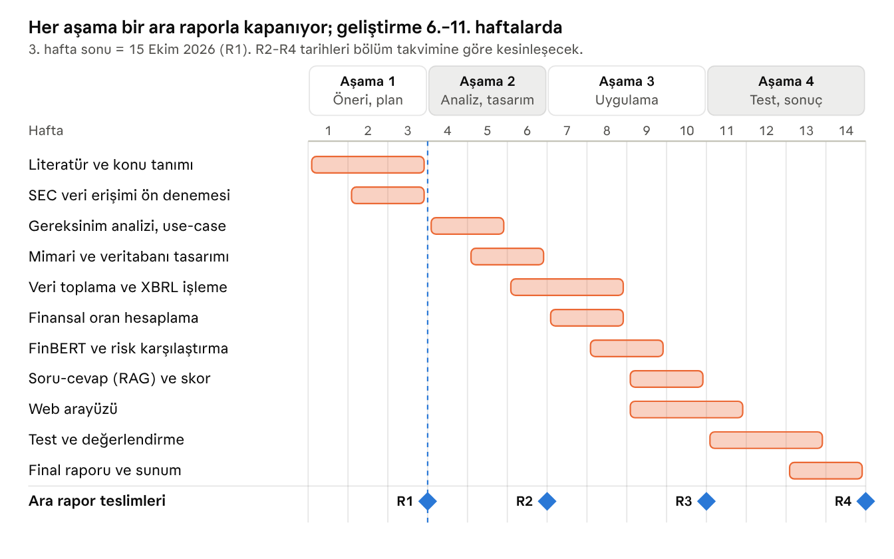

# FinSight AI — 1. Ara Rapor: Proje Önerisi ve Planlama

**\[ÜNİVERSİTE ADI\]**

**\[FAKÜLTE ADI\] — BİLGİSAYAR MÜHENDİSLİĞİ BÖLÜMÜ**

**TASARIM PROJESİ**

**FinSight AI: Yapay Zekâ Destekli Finansal Rapor Analiz ve Risk
Değerlendirme Platformu**

**1. Ara Rapor: Proje Önerisi ve Planlama**

Hazırlayan: \[Ad Soyad\] — \[Öğrenci Numarası\]

Danışman: \[Unvan Ad Soyad\]

Teslim Tarihi: 15 Ekim 2026

## 1. Proje Tanımı

### 1.1. Problem ve Motivasyon

Amerika Birleşik Devletleri'nde borsada işlem gören şirketler, finansal
durumlarını ABD Menkul Kıymetler ve Borsa Komisyonu'na (SEC) düzenli
olarak raporlamak zorundadır. Yıllık faaliyet raporu olan 10-K,
çeyreklik rapor olan 10-Q ve önemli gelişmeleri bildiren 8-K formları,
SEC'in EDGAR sistemi üzerinden herkesin erişimine açıktır. Ancak bu
raporlara erişmek kolay olsa da onları anlamak kolay değildir. Bir 10-K
raporu çoğu zaman yüzlerce sayfadan oluşur ve hem sayısal tabloları hem
de uzun, teknik bir dille yazılmış risk ve yönetim değerlendirmelerini
içerir.

Bu raporlardaki bilgi iki farklı biçimde bulunur. Gelir, kâr ve borç
gibi sayısal değerler XBRL adı verilen yapılandırılmış bir formatta
etiketlenmiştir. Risk faktörleri ve yönetimin şirketin durumuna ilişkin
değerlendirmesi ise serbest metin olarak yazılmıştır. Uygulamada bu iki
tür veri genellikle ayrı araçlarla incelenir; sayısal değişimlerle
metinde anlatılanlar arasında bağlantı kurmak okuyucuya kalır. Son
yıllarda yaygınlaşan büyük dil modelleri bu konuda yardımcı olabilecek
gibi görünse de, kaynak göstermeden ve doğrulanamayan cevaplar
üretebilmeleri finansal bir bağlamda ciddi bir sorundur.

Bu projenin çıkış noktası şu sorudur: SEC raporlarındaki sayısal ve
metinsel veriler tek bir sistemde birleştirilerek, dönemsel değişimleri
hesaplayan, metindeki risk ve ton sinyallerini çıkaran ve kullanıcının
sorularını yalnızca rapor içeriğine dayanarak, kaynak göstererek
cevaplayan bir platform geliştirilebilir mi?

### 1.2. Projenin Amacı

Projenin amacı, kullanıcının seçtiği bir ABD şirketinin SEC raporlarını
otomatik olarak toplayan ve analiz eden web tabanlı bir platform
geliştirmektir. Geliştirilecek sistemin temel işlevleri şunlardır:

1.  Şirketin 10-K, 10-Q ve 8-K raporlarını SEC EDGAR üzerinden bulmak ve
    listelemek.

2.  XBRL verisinden gelir, net kâr, toplam varlık, toplam borç, özkaynak
    ve nakit akışı gibi temel kalemleri çıkarmak.

3.  Son üç mali yıl için dönemsel değişimleri ve 8-10 temel finansal
    oranı hesaplamak.

4.  Risk Faktörleri ve Yönetimin Değerlendirmesi (MD&A) bölümlerinde
    finansal metinler için geliştirilmiş bir dil modeliyle duygu analizi
    yapmak.

5.  Ardışık iki yılın risk bölümlerini karşılaştırarak eklenen ve
    çıkarılan riskleri göstermek.

6.  Kullanıcının rapor hakkındaki sorularını, ilgili rapor bölümünü
    kaynak olarak göstererek cevaplamak.

7.  Bileşenleri ve ağırlıkları açıkça görülebilen, 100 üzerinden bir
    finansal sağlık ve risk skoru üretmek.

Sistem bir karar destek aracı olarak tasarlanmaktadır. Herhangi bir
hisse için alım ya da satım önerisi üretmesi amaçlanmamaktadır.

### 1.3. Proje Kapsamı

Projenin bir dönem içinde tamamlanabilmesi için kapsam bilinçli olarak
sınırlandırılmıştır. Tablo 1'de projenin ilk sürümüne dahil edilen ve
edilmeyen konular verilmiştir.

**Tablo 1.** Projenin kapsamı

| Kapsama dahil olanlar                                        | Kapsam dışında kalanlar                         |
|--------------------------------------------------------------|-------------------------------------------------|
| Yalnızca ABD şirketleri, farklı sektörlerden en az 10 şirket | Borsadaki tüm şirketlerin aynı anda taranması   |
| 10-K, 10-Q ve 8-K formları                                   | 20-F, S-1, Form 4 gibi diğer form türleri       |
| Son üç mali yılın karşılaştırılması                          | Uzun dönemli zaman serisi analizi               |
| 8-10 temel finansal oran                                     | Bankacılık gibi sektörlere özel ileri metrikler |
| FinBERT ile duygu analizi ve risk bölümü karşılaştırması     | Dil modelinin sıfırdan eğitilmesi               |
| Kaynak gösteren soru-cevap modülü                            | Hisse fiyatı tahmini                            |
| Açıklanabilir şirket skoru                                   | Yatırım tavsiyesi, gerçek parayla işlem         |
| Web arayüzü ve Docker ile kurulum                            | Mobil uygulama, portföy optimizasyonu           |

Bankalar ve sigorta şirketleri finansal tablolarını farklı kalemlerle
raporladığı için brüt kâr marjı ve cari oran gibi göstergeler bu
şirketlerde anlamlı değildir. Bu nedenle ilk sürümde şirket listesinin
finans dışı sektörlerden seçilmesi planlanmaktadır.

### 1.4. Projenin Önemi ve Katma Değeri

Finansal rapor analizi genellikle ya ücretli profesyonel veri
platformlarıyla ya da raporların elle okunmasıyla yapılmaktadır.
Ücretsiz araçların büyük kısmı ise ya yalnızca sayısal veriyi gösterir
ya da metin üzerinde çalışır. Bu proje, kamuya açık ve ücretsiz bir veri
kaynağını kullanarak iki veri türünü aynı ekranda birleştirmeyi
hedeflemektedir.

Projenin öne çıkan katkıları şöyle özetlenebilir:

- **İzlenebilirlik:** Sistemde gösterilen her sayısal değer, hangi
  rapordan ve hangi XBRL etiketinden alındığı bilgisiyle birlikte
  saklanacaktır. Kullanıcı bir değerin kaynağını doğrudan kontrol
  edebilecektir.

- **Kaynak gösteren cevaplar:** Soru-cevap modülü, cevabını yalnızca
  ilgili rapor bölümlerine dayandıracak ve bu bölümleri kullanıcıya
  gösterecektir. Raporda bulunmayan bir bilgi sorulduğunda sistemin
  tahmin yürütmek yerine bunu belirtmesi amaçlanmaktadır.

- **Açıklanabilir skor:** Şirket skoru tek bir "kara kutu" puanı olarak
  değil, hangi bileşenden kaç puan geldiği görülecek şekilde
  sunulacaktır.

- **Değişimin görünür olması:** Risk bölümlerinin yıllar arasında
  karşılaştırılması, şirketin yeni hangi risklerden söz etmeye
  başladığını hızlıca görmeyi sağlayacaktır.

Proje aynı zamanda veri mühendisliği (dış bir API'den kurallara uygun
veri toplama ve temizleme), doğal dil işleme ve web geliştirme
konularını tek bir uygulamada bir araya getirdiği için bilgisayar
mühendisliği eğitimi açısından da kapsamlı bir çalışma niteliğindedir.

## 2. Literatür Özeti

Proje konusu; finansal metin analizi, alana özgü dil modelleri, erişim
destekli soru-cevap sistemleri ve finansal oranlara dayalı değerlendirme
olmak üzere dört araştırma alanının kesişiminde yer almaktadır. Bu
bölümde her alandan projenin tasarımını doğrudan etkileyen çalışmalar
özetlenmiştir. Daha ayrıntılı literatür taraması ikinci ara raporda
sunulacaktır.

### 2.1. Finansal Metinlerde Ton Analizi

Finansal metin analizi alanındaki en çok atıf alan çalışmalardan biri
Loughran ve McDonald (2011) tarafından yapılmıştır. Yazarlar, genel
amaçlı bir sözlükte olumsuz olarak sınıflandırılan kelimelerin yaklaşık
dörtte üçünün 10-K raporlarında olumsuz bir anlam taşımadığını
göstermiştir. Örneğin "liability" (yükümlülük) ya da "cost" (maliyet)
gibi kelimeler günlük dilde olumsuz algılansa da finansal raporlarda
tarafsız, teknik terimlerdir. Bu nedenle yazarlar finans alanına özel
kelime listeleri geliştirmiştir. Li (2010) ise şirket raporlarındaki
ileriye dönük ifadelerin tonunu Naive Bayes sınıflandırıcısıyla ölçmüş
ve genel amaçlı sözlüklerle ölçülen tonun şirketin sonraki performansını
iyi açıklamadığını, makine öğrenmesiyle belirlenen tonun ise sonraki
dönem kazançlarıyla ilişkili olduğunu bulmuştur.

Bu iki çalışma, projede finansal metinler için genel amaçlı bir duygu
analizi aracı yerine alana özgü bir yöntem kullanılması gerektiğini
göstermektedir. Loughran-McDonald sözlüğü ayrıca projede karşılaştırma
için temel yöntem olarak kullanılacaktır.

### 2.2. Rapor Metnindeki Değişimler

Cohen, Malloy ve Nguyen (2020), şirketlerin 10-K ve 10-Q raporlarını
yıldan yıla büyük ölçüde aynı metinle hazırladığını, bu nedenle metinde
yapılan değişikliklerin bilgi taşıdığını ileri sürmüştür. Çalışmada
rapor dilini belirgin şekilde değiştiren şirketlerin sonraki dönemlerde
daha zayıf getiri, kazanç ve kârlılık gösterdiği; özellikle risk
faktörleri bölümündeki değişikliklerin bu ilişkide önemli rol oynadığı
raporlanmıştır. Yazarlar aynı zamanda yatırımcıların bu değişikliklere
yeterince dikkat etmediğini belirtmektedir. Bu bulgu, projedeki risk
bölümü karşılaştırma modülünün temel gerekçesini oluşturmaktadır: İki
dönem arasında eklenen veya çıkarılan risk paragraflarını otomatik
olarak göstermek, okuyucunun gözden kaçırabileceği bir sinyali görünür
kılmaktadır.

### 2.3. Alana Özgü Dil Modelleri: FinBERT

Araci (2019), BERT dil modelini finansal metinler üzerinde ek olarak
eğiterek FinBERT modelini geliştirmiş ve finansal cümlelerin olumlu,
olumsuz ve tarafsız olarak sınıflandırılmasında önceki yöntemlerden daha
iyi sonuç elde ettiğini göstermiştir. Huang, Wang ve Yang (2023) ise
farklı bir FinBERT sürümünü analist raporları ve şirket açıklamaları
üzerinde değerlendirmiş; modelin Loughran-McDonald sözlüğüne ve klasik
makine öğrenmesi yöntemlerine göre daha yüksek doğruluk sağladığını, bu
farkın eğitim verisinin az olduğu durumlarda daha da belirginleştiğini
raporlamıştır.

Projede duygu analizi için Araci'nin çalışmasına dayanan ve açık olarak
paylaşılan hazır FinBERT modeli kullanılacaktır. Modelin yeniden
eğitilmesi planlanmamaktadır; ancak modelin 10-K dilindeki başarımı elle
etiketlenmiş küçük bir cümle kümesi üzerinde ölçülecektir.

### 2.4. Erişim Destekli Üretim ve Finansal Soru-Cevap

Lewis ve arkadaşları (2020), bir dil modelinin cevap üretmeden önce
harici bir belge koleksiyonundan ilgili parçaları getirmesine dayanan
erişim destekli üretim (Retrieval-Augmented Generation, RAG) yöntemini
önermiştir. Bu yöntem, modelin cevabını belirli kaynaklara dayandırmayı
ve kaynağı göstermeyi mümkün kılmaktadır. Belgelerin anlamsal benzerliğe
göre aranabilmesi için cümle ve paragrafların vektörlere dönüştürülmesi
gerekir; Reimers ve Gurevych (2019) tarafından geliştirilen
Sentence-BERT yaklaşımı bu işlemi verimli biçimde yapmaktadır.

Finansal raporlar üzerinde soru-cevap konusunda iki çalışma öne
çıkmaktadır. Chen ve arkadaşları (2021), S&P 500 şirketlerinin finansal
raporlarından oluşturulan ve sayısal akıl yürütme gerektiren FinQA veri
setini yayımlamıştır. Islam ve arkadaşları (2023) ise SEC raporlarına
dayanan 10.231 soruluk FinanceBench veri setini oluşturmuş ve erişim
sistemiyle desteklenen GPT-4-Turbo modelinin soruların %81'ini yanlış
cevapladığını ya da cevaplamayı reddettiğini raporlamıştır. Bu sonuç,
finansal soru-cevabın güncel büyük dil modelleri için bile zor bir
problem olduğunu göstermektedir. Projede bu nedenle iddialı bir doğruluk
hedefi yerine, cevapların kaynağa dayalı olması ve kaynak
bulunamadığında sistemin bunu açıkça belirtmesi öncelikli hedef olarak
belirlenmiştir.

### 2.5. Finansal Oranlara Dayalı Değerlendirme

Finansal tablolardan elde edilen oranlarla şirket değerlendirmesi
yapılmasının uzun bir geçmişi vardır. Altman (1968), beş finansal oranı
diskriminant analizi ile birleştirerek şirket iflasını öngörmeye yönelik
Z-skorunu geliştirmiştir. Piotroski (2000) ise kârlılık, kaldıraç,
likidite ve faaliyet verimliliğine ilişkin dokuz basit ölçütün
toplamından oluşan F-skorunu önermiştir. F-skorunun her bileşeninin tek
tek yorumlanabilmesi, bu projede hedeflenen açıklanabilir skor yapısına
örnek oluşturmaktadır. Projede geliştirilecek skor bu iki yöntemin
yerine geçmek amacı taşımamakta, onlara benzer şekilde bileşenleri
görülebilen bir özet gösterge sunmayı amaçlamaktadır.

### 2.6. Değerlendirme

Literatür incelendiğinde, finansal metin analizi ve finansal oran
analizinin genellikle ayrı çalışma alanları olarak ele alındığı
görülmektedir. Soru-cevap çalışmaları ise büyük ölçüde model başarımını
ölçmeye odaklanmaktadır. Bu proje yeni bir model geliştirmeyi değil, bu
alanlarda kendini kanıtlamış yöntemleri kamuya açık SEC verisi üzerinde
tek bir uygulamada birleştirmeyi ve her çıktının kaynağını izlenebilir
kılmayı hedeflemektedir.

## 3. Projenin Teknik Altyapısı

### 3.1. Veri Kaynağı

Projede kullanılacak tüm finansal veriler SEC'in EDGAR sisteminden
alınacaktır. SEC, data.sec.gov adresi üzerinden şirketlerin başvuru
geçmişini (submissions) ve finansal tablolardan çıkarılmış XBRL
verilerini (companyfacts) JSON formatında sunmaktadır. Bu servisler
kimlik doğrulama veya API anahtarı gerektirmemektedir (U.S. Securities
and Exchange Commission \[SEC\], 2025a). Raporların tam metni ise EDGAR
arşivinden HTML olarak indirilebilmektedir.

SEC bu servislerin kullanımı için bazı kurallar belirlemiştir. Her
kullanıcının saniyede en fazla 10 istek göndermesine izin verilmekte, bu
sınırı aşan IP adreslerinin engellenebileceği belirtilmektedir (SEC,
2025b). Ayrıca otomatik isteklerin, gönderen uygulamayı ve iletişim
bilgisini tanımlayan bir User-Agent başlığı taşıması istenmektedir.
Projede bu kurallara uymak için SEC'e giden tüm istekler tek bir istemci
modülü üzerinden geçecek, istek hızı güvenlik payı bırakmak amacıyla
saniyede 8 ile sınırlandırılacak ve aynı verinin tekrar tekrar
indirilmemesi için önbellek kullanılacaktır.

### 3.2. Yazılım Teknolojileri

Teknoloji seçiminde, bir dönem içinde tek kişi tarafından öğrenilip
kullanılabilecek, ücretsiz ve geniş kaynak desteği olan araçlar tercih
edilmiştir. Kullanılacak teknolojiler Tablo 2'de verilmiştir.

**Tablo 2.** Projede kullanılacak yazılım teknolojileri

| Katman               | Teknoloji                           | Seçim gerekçesi                                                                                        |
|----------------------|-------------------------------------|--------------------------------------------------------------------------------------------------------|
| Programlama dili     | Python 3.12                         | Doğal dil işleme ve veri işleme kütüphanelerinin büyük kısmı Python ile geliştirilmiştir               |
| Sunucu (backend)     | FastAPI                             | Otomatik API belgelendirmesi sağlar, veri doğrulaması için Pydantic kullanır                           |
| Veritabanı           | PostgreSQL                          | İlişkisel veri bütünlüğü ve hassas sayısal veri türleri sunar                                          |
| Vektör arama         | pgvector                            | Ayrı bir servis gerektirmeden PostgreSQL içinde vektör araması yapar                                   |
| Veritabanı erişimi   | SQLAlchemy                          | Veritabanından bağımsız kod yazılmasını ve test edilmesini kolaylaştırır                               |
| Duygu analizi        | FinBERT (ProsusAI/finbert)          | Finansal metinler için hazır sınıflandırma modeli (Araci, 2019)                                        |
| Metin vektörleştirme | Sentence Transformers               | Anlamsal arama için verimli cümle vektörleri üretir                                                    |
| Cevap üretimi        | Ücretli bir büyük dil modeli API'si | Yerel donanım büyük model çalıştırmak için yetersizdir; bölüm ücretli API kullanımına izin vermektedir |
| Arayüz (frontend)    | React / Next.js, Recharts           | Yaygın kullanım, hazır grafik bileşenleri                                                              |
| Test                 | pytest, FastAPI TestClient          | SEC'e gerçek istek atmadan birim ve API testleri yapılabilir                                           |
| Kurulum              | Docker Compose                      | Sistemin tek komutla başka bir bilgisayarda çalıştırılabilmesi                                         |
| Sürüm kontrolü       | Git, GitHub                         | Kod geçmişinin ve değişikliklerin takibi                                                               |

Cevap üretiminde kullanılacak dil modeli sağlayıcısı ve model sürümü
ikinci aşamada kesinleştirilecektir. Sistem, sağlayıcı gerektiğinde
değiştirilebilecek şekilde tasarlanacaktır. API maliyetlerini kontrol
altında tutmak için istek başına metin uzunluğu sınırlanacak ve her
çağrı kayıt altına alınacaktır.

### 3.3. Donanım

Geliştirme, ASUS X515JF dizüstü bilgisayar üzerinde yapılacaktır.
Bilgisayarda 2 GB bellekli bir ekran kartı bulunmaktadır. Bu bellek
miktarı büyük dil modellerini yerel olarak çalıştırmak için yeterli
değildir; bu nedenle cevap üretimi bulut tabanlı bir API üzerinden
yapılacaktır. FinBERT ve cümle vektörleştirme modelleri göreceli olarak
küçük modeller olduğundan işlemcide (CPU) çalıştırılacaktır. Bu
modellerin çıktıları veritabanına kaydedileceği için her rapor yalnızca
bir kez işlenecektir. İşlem süresinin kabul edilemeyecek kadar uzun
olması durumunda, toplu işlemlerin Google Colab üzerinde çalıştırılması
yedek plan olarak belirlenmiştir.

### 3.4. Sistemin Genel Yapısı

Sistemin dört ana katmandan oluşması planlanmaktadır. **Veri toplama
katmanı** SEC'ten başvuru listelerini, XBRL verilerini ve rapor
metinlerini çeker. **Analiz katmanı** finansal oranları hesaplar,
metinden risk ve yönetim değerlendirmesi bölümlerini ayıklar, duygu
analizini ve risk karşılaştırmasını yapar. **Depolama katmanı** tüm
verileri ve metin vektörlerini PostgreSQL üzerinde saklar. **Sunum
katmanı** ise FastAPI ile geliştirilen REST servisleri ve bu servisleri
kullanan web arayüzünden oluşur. Sistem mimarisi, veritabanı tasarımı ve
kullanım senaryoları ikinci ara raporda ayrıntılı olarak sunulacaktır.

### 3.5. Yapılabilirlik İçin Ön Çalışma

Projenin en kritik bağımlılığı SEC verisine kurallara uygun ve güvenilir
biçimde erişilebilmesidir. Bu nedenle planlama aşamasında küçük bir veri
çekme prototipi geliştirilmiştir. Prototip; verilen bir hisse kodu için
şirketin SEC kimlik numarasını (CIK) bulmakta, 10-K, 10-Q ve 8-K
başvurularını listelemekte, son üç mali yıla ait altı temel finansal
kalemi XBRL verisinden çıkarmakta ve sonuçları veritabanına
kaydetmektedir. Elde edilen veriler iki REST servisi üzerinden
sunulmaktadır.

Prototip geliştirilirken XBRL verisiyle ilgili bazı pratik sorunlarla
karşılaşılmış ve bunlar için kurallar belirlenmiştir:

- Aynı finansal değer, sonraki yılların raporlarında karşılaştırma
  sütunu olarak tekrar yer almaktadır. Aynı dönem için birden fazla
  kayıt bulunduğunda en son yayımlanan rapordaki değer seçilmektedir.

- Yıllık raporların içinde çeyreklik değerler de bulunabilmektedir. Bu
  değerleri ayırmak için dönem uzunluğu kontrol edilmektedir.

- Şirketler aynı kalem için farklı yıllarda farklı XBRL etiketleri
  kullanabilmektedir. Bu durum için her kaleme öncelik sıralı bir yedek
  etiket listesi tanımlanmıştır.

- Bazı şirketlerin mali yılı takvim yılıyla örtüşmemektedir. Bu nedenle
  sonuçlarda yıl yerine dönem başlangıç ve bitiş tarihleri
  gösterilmektedir.

Prototip için yazılan 33 birim ve API testinin tümü başarıyla
çalışmıştır. Testler SEC'e gerçek istek atmadan, örnek veriler üzerinde;
User-Agent zorunluluğunu, istek hızı sınırını, hata durumunda yeniden
denemeyi ve yukarıdaki ayıklama kurallarını kontrol etmektedir. Prototip
gerçek SEC verisiyle de çalıştırılmış ve örneğin Microsoft için Temmuz
2023 – Haziran 2024 mali yılına ait net kâr 88.136 milyon USD, Temmuz
2024 – Haziran 2025 mali yılına ait net kâr 101.832 milyon USD olarak,
kaynak 10-K raporunun numarasıyla birlikte alınmıştır (Şekil 1). Bu
sonuç, projenin veri altyapısının uygulanabilir olduğunu göstermektedir.
Elde edilen değerlerin 10-K tablolarıyla sistematik olarak
karşılaştırılması ikinci aşamada yapılacaktır.

*\[Şekil 1 buraya eklenecek: Swagger arayüzünde /companies/MSFT/facts
servisinin yanıtını gösteren ekran görüntüsü\]*

**Şekil 1.** Prototipin Microsoft için döndürdüğü net kâr verileri ve
kaynak bilgisi

## 4. Proje Zaman Çizelgesi

Proje 14 haftalık bir dönem içinde dört aşamada tamamlanacak şekilde
planlanmıştır. Her aşama bir ara rapor ve sunumla sonuçlanmaktadır.
Aşamaların sırası, bölüm tarafından istenen ara rapor içerikleriyle
uyumlu olacak şekilde belirlenmiştir. Planlanan iş adımları ve süreleri
Şekil 2'deki Gantt şemasında gösterilmiştir.

Şekil 2. Proje zaman çizelgesi (Gantt şeması)

**Aşama 1 – Proje önerisi ve planlama:** Proje konusunun belirlenmesi,
literatürün incelenmesi, teknolojilerin seçilmesi ve SEC verisine
erişimin bir prototiple denenmesi. Bu aşama birinci ara raporla (R1)
tamamlanmaktadır.

**Aşama 2 – Analiz ve tasarım:** Literatür taramasının genişletilmesi,
işlevsel ve işlevsel olmayan gereksinimlerin belirlenmesi, kullanım
senaryolarının çıkarılması, sistem mimarisinin, veritabanının ve arayüz
taslaklarının tasarlanması. Tasarımın netleşmesiyle birlikte 6. haftada
veri toplama modülünün geliştirilmesine başlanacaktır.

**Aşama 3 – Uygulama ve geliştirme:** XBRL verisinin işlenmesi ve
finansal oranların hesaplanması, rapor metinlerinden ilgili bölümlerin
ayıklanması, FinBERT ile duygu analizi, risk bölümlerinin
karşılaştırılması, soru-cevap modülü, skor hesaplaması ve web arayüzü.
Projenin en yoğun ve en riskli aşaması budur. Süre aşımı olması
durumunda iki şirketi yan yana karşılaştırma ve PDF olarak dışa aktarma
gibi ikincil özellikler ertelenecektir.

**Aşama 4 – Test, değerlendirme ve sonuçlandırma:** Birim, API ve uçtan
uca testler, Bölüm 5'te belirtilen değerlendirme çalışmaları, küçük bir
kullanılabilirlik testi, hata düzeltmeleri ile final raporu ve sunumunun
hazırlanması.

## 5. Beklenen Sonuçlar

Projenin sonunda, kullanıcının bir ABD şirketini seçerek o şirketin SEC
raporlarına ilişkin özet bir analiz alabildiği, çalışır durumda bir web
uygulaması elde edilmesi beklenmektedir. Kullanıcı uygulamada şirketin
rapor listesini, son üç yıla ait temel finansal kalemleri ve oranları
grafiklerle görebilecek; risk bölümünde iki yıl arasında neyin
değiştiğini inceleyebilecek ve rapor hakkında doğal dilde soru
sorabilecektir. Sistemin verdiği her cevap ve gösterdiği her sayı,
kaynağı olan raporla birlikte sunulacaktır.

Proje sonunda teslim edilmesi planlanan çıktılar şunlardır:

1.  Docker ile tek komutla kurulabilen, kaynak kodu belgelenmiş web
    uygulaması

2.  Farklı sektörlerden en az 10 şirkete ait işlenmiş veri kümesi

3.  Sistemin tüm temel bileşenlerini kapsayan otomatik testler

4.  Duygu analizi, soru-cevap ve skor modüllerinin değerlendirme
    sonuçları

5.  Ara raporlar, final raporu ve uygulama tanıtım videosu

Değerlendirme aşamasında şu ölçümlerin yapılması planlanmaktadır:
XBRL'den çıkarılan değerlerin rapor tablolarıyla elle karşılaştırılması,
FinBERT ile Loughran-McDonald sözlüğünün elle etiketlenmiş bir cümle
kümesi üzerinde karşılaştırılması, soru-cevap modülünün hazırlanacak bir
soru listesiyle test edilerek cevapların kaynağa ne ölçüde dayandığının
incelenmesi ve skor ağırlıkları değiştirildiğinde sonuçların nasıl
etkilendiğinin gözlenmesi. Bu değerlendirmelerin sonuçları henüz
bilinmemektedir ve dördüncü ara raporda sunulacaktır.

Geliştirilecek sistemin bir yatırım tavsiyesi aracı olmadığını tekrar
vurgulamak gerekir. Uygulamanın tüm analiz ekranlarında bu durumu
belirten bir uyarı yer alacak, skor ve analizler alım-satım önerisi
olarak değil, raporun daha hızlı anlaşılmasına yardımcı olan özet
göstergeler olarak sunulacaktır.

## Kaynaklar

Altman, E. I. (1968). Financial ratios, discriminant analysis and the
prediction of corporate bankruptcy. *The Journal of Finance, 23*(4),
589–609. https://doi.org/10.1111/j.1540-6261.1968.tb00843.x

Araci, D. (2019). *FinBERT: Financial sentiment analysis with
pre-trained language models* (arXiv:1908.10063). arXiv.
https://arxiv.org/abs/1908.10063

Chen, Z., Chen, W., Smiley, C., Shah, S., Borova, I., Langdon, D.,
Moussa, R., Beane, M., Huang, T.-H., Routledge, B., & Wang, W. Y.
(2021). FinQA: A dataset of numerical reasoning over financial data. In
*Proceedings of the 2021 Conference on Empirical Methods in Natural
Language Processing* (pp. 3697–3711). Association for Computational
Linguistics.

Cohen, L., Malloy, C., & Nguyen, Q. (2020). Lazy prices. *The Journal of
Finance, 75*(3), 1371–1415. https://doi.org/10.1111/jofi.12885

Huang, A. H., Wang, H., & Yang, Y. (2023). FinBERT: A large language
model for extracting information from financial text. *Contemporary
Accounting Research, 40*(2), 806–841.
https://doi.org/10.1111/1911-3846.12832

Islam, P., Kannappan, A., Kiela, D., Qian, R., Scherrer, N., & Vidgen,
B. (2023). *FinanceBench: A new benchmark for financial question
answering* (arXiv:2311.11944). arXiv. https://arxiv.org/abs/2311.11944

Lewis, P., Perez, E., Piktus, A., Petroni, F., Karpukhin, V., Goyal, N.,
Küttler, H., Lewis, M., Yih, W., Rocktäschel, T., Riedel, S., & Kiela,
D. (2020). Retrieval-augmented generation for knowledge-intensive NLP
tasks. *Advances in Neural Information Processing Systems, 33*,
9459–9474.

Li, F. (2010). The information content of forward-looking statements in
corporate filings—A naïve Bayesian machine learning approach. *Journal
of Accounting Research, 48*(5), 1049–1102.
https://doi.org/10.1111/j.1475-679X.2010.00382.x

Loughran, T., & McDonald, B. (2011). When is a liability not a
liability? Textual analysis, dictionaries, and 10-Ks. *The Journal of
Finance, 66*(1), 35–65. https://doi.org/10.1111/j.1540-6261.2010.01625.x

Piotroski, J. D. (2000). Value investing: The use of historical
financial statement information to separate winners from losers.
*Journal of Accounting Research, 38*(Supplement), 1–41.
https://doi.org/10.2307/2672906

Reimers, N., & Gurevych, I. (2019). Sentence-BERT: Sentence embeddings
using Siamese BERT-networks. In *Proceedings of the 2019 Conference on
Empirical Methods in Natural Language Processing and the 9th
International Joint Conference on Natural Language Processing* (pp.
3982–3992). Association for Computational Linguistics.

U.S. Securities and Exchange Commission. (2025a). *EDGAR application
programming interfaces (APIs)*. Erişim tarihi 14 Ekim 2026,
https://www.sec.gov/search-filings/edgar-application-programming-interfaces

U.S. Securities and Exchange Commission. (2025b). *Developer resources*.
Erişim tarihi 14 Ekim 2026,
https://www.sec.gov/about/developer-resources
